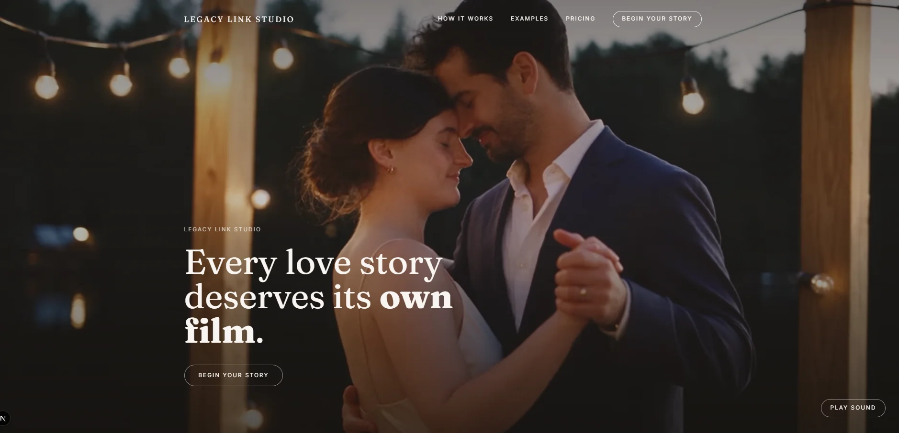

# Legacy Link Studio — cinematic love story films, from your own footage

A direct-to-consumer studio that turns a couple's real photos and clips into a
60–90 second cinematic short film, delivered as a private "capsule" link that
stays locked until a date the buyer chooses. The site runs the whole customer
side: the story, the examples, pricing, a guided intake, and the capsule reveal.



## See it

| | |
|---|---|
| **Live site** | **https://legacylinkstudio.com** — currently in waitlist mode |
| Vercel deployment | https://legacy-link-studio.vercel.app |

## Who it's for

- **Couples** marking a relationship milestone (a wedding, an anniversary, a
  proposal), or no milestone at all, who want to keep their scattered
  photos and clips as something worth watching again.
- **Gift-givers** (a friend, a family member, or one partner surprising the
  other) buying a film on a couple's behalf and choosing when it unlocks.

## What it does

- **Three packages:** *Spark* ($59, self-serve, 4 motion photos), *Forever*
  ($169, commissioned 60–90 second film), and *Heirloom* ($209, Forever plus
  the Display device). Prices live in one place (`src/lib/intake-labels.ts`),
  so `/pricing`, the intake and the waitlist always agree.
- **Guided intake** (`/start`): couple, story prompts (how they met, early
  days, a secret detail), tone and music, footage, gift-giver details, and the
  reveal date, as a multi-step Framer Motion flow.
- **Capsule** (`/capsule/[token]`): a private link that stays locked until the
  reveal date, then remains permanently accessible at the same URL.
- **Waitlist mode:** while `NEXT_PUBLIC_CHECKOUT_ENABLED` is unset, every CTA
  says "Join the waitlist" and `src/middleware.ts` redirects `/start`,
  `/checkout` and `/gift` to `/waitlist`. Nothing is deleted, so setting the
  flag to `true` brings the full flow back.
- **Signups and attribution:** the waitlist posts to Formspree (or to Supabase
  once its env vars are set), sends a Resend confirmation email, and records
  first-touch `utm_*`, referrer and landing path so Instagram and TikTok bio
  links can be measured.

## Tech stack

- **Next.js 15** (App Router) + **React 19** + **TypeScript**
- **Tailwind CSS** for styling, **Framer Motion** for the intake and page transitions
- **Formspree** for waitlist signups and orders. **Supabase** is optional
  (migration in `supabase/migrations/`) and also powers `/admin/waitlist`
- **Resend** for the waitlist confirmation email
- **Vercel** hosting, auto-deployed from `main`

```bash
npm install
cp .env.example .env.local   # every variable is optional; see comments inside
npm run dev
```

## Build spec & decisions

The full brief is in [`docs/legacy-link-studio-master-build-brief.md`](docs/legacy-link-studio-master-build-brief.md),
with the site spec in [`docs/legacy-link-studio-site-spec.md`](docs/legacy-link-studio-site-spec.md).
Durable product truth lives in [`PRODUCT.md`](PRODUCT.md), and the design
system in [`DESIGN.md`](DESIGN.md). The running build log, including known
limitations and bugs fixed along the way, is [`docs/progress.md`](docs/progress.md).

## One thing I'd improve

**Real footage uploads.** The intake collects a couple's photos, clips and voice
notes, but only the *counts* reach the studio. `src/lib/submit-order.ts`
sends the story answers to Formspree, and the files themselves go nowhere. That's
fine during the waitlist, but it's the first thing that has to change
before checkout is switched on, because a film can't be made without the
footage. The fix is direct-to-storage uploads (e.g. Vercel Blob or Supabase
Storage) from the footage step, with the file links attached to the order.
